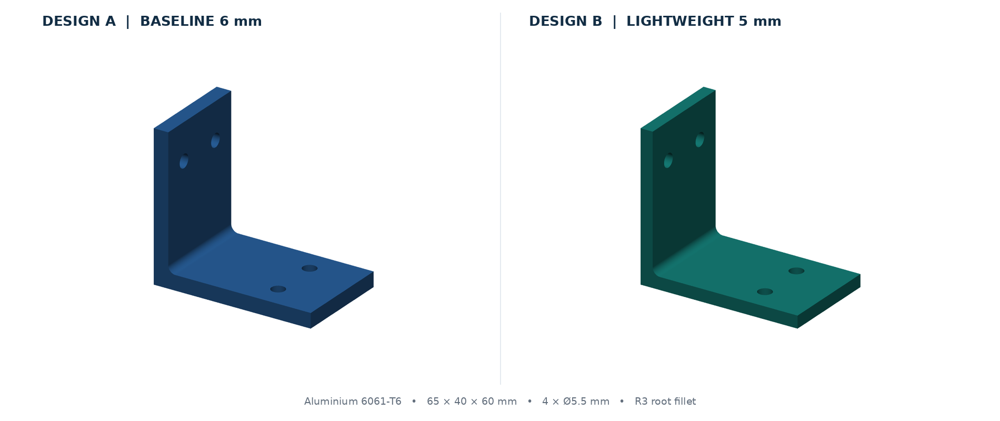
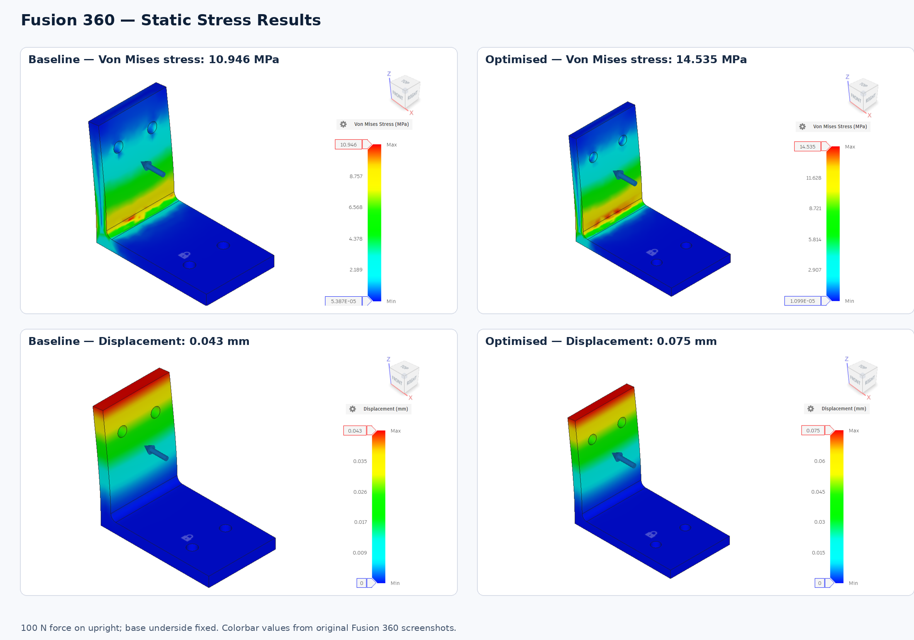

# Lightweight Aircraft Bracket — Structural Optimisation

A Fusion 360 CAD + static-stress project comparing a 6 mm aluminium 6061-T6 L-bracket with a lighter 5 mm version. Both models use the same geometry, four mounting holes, material, fixed base underside and 100 N outward load on the upright.

## Results

| Measurement | Baseline (6 mm) | Optimised (5 mm) |
|---|---:|---:|
| Estimated mass | 75.78 g | 63.73 g |
| Maximum von Mises stress | 10.946 MPa | 14.535 MPa |
| Maximum displacement | 0.043 mm | 0.075 mm |
| Displayed safety factor | Above 8 | Above 8 |

**Estimated mass reduction: 15.91%.** The optimised design meets the project targets of at least 10% lower mass, safety factor above 2 and displacement below 0.75 mm.

## Files

- [Engineering report (PDF)](Engineering_Report.pdf) — full design and comparison.
- [Baseline CAD (STEP)](Bracket_Baseline.step) — 6 mm bracket.
- [Optimised CAD (STEP)](Bracket_Optimized.step) — 5 mm bracket.
- `CAD_Designs.png` and `FEA_Results.png` — project figures.

*Educational structural comparison, not a certified aerospace component. Mass values are calculated from CAD volumes; structural results are taken from Fusion 360. The base is idealised as fully fixed and mesh convergence is not established.*
